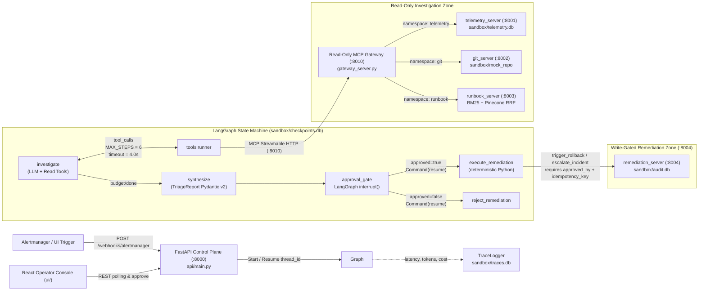

# TraceGate

TraceGate is an autonomous SRE incident triage and human-in-the-loop (HITL) remediation platform built with LangGraph, FastMCP, FastAPI, and React. It ingests firing alerts via an Alertmanager-compatible webhook, executes a bounded read-only investigation across telemetry, git history, and runbooks through an isolated MCP gateway (`:8010`), produces a schema-validated, citation-backed `TriageReport`, pauses at a durable LangGraph `interrupt()` gate, and dispatches state-mutating remediation actions (`:8004`) deterministically only after explicit human approval.

<!-- Add UI screenshot here -->

## Architecture

TraceGate enforces a strict boundary between autonomous read-only investigation (`:8010`) and human-gated write execution (`:8004`):



## Core Safety & Engineering Invariants

1. **Architectural Read/Write Isolation (`mcp_server/gateway/gateway_server.py`, `agent/mcp_client.py`)**
   - The LangGraph reasoning agent binds exclusively to tools exposed by the read-only gateway on `:8010` (`telemetry`, `git`, `runbook`). Write tools (`trigger_rollback`, `escalate_incident`) live strictly on `:8004` and are never mounted on `:8010`.
   - At FastAPI startup, `load_tools()` asserts that no forbidden write tool name appears on `:8010` and raises `RuntimeError` if the boundary is violated. Untrusted log lines, stack traces, and commit diffs structurally cannot invoke mutating operations.

2. **Deterministic Remediation & Idempotency (`agent/graph.py`, `mcp_server/servers/remediation_server.py`)**
   - The LLM never calls `:8004` directly and never generates `idempotency_key` or `approved_by`.
   - After human approval resumes execution, `execute_remediation` constructs `idempotency_key` in plain Python (`{incident_id}:rollback:{target_sha}` or `{incident_id}:escalate:{severity}`) and calls `call_remediation_tool()` with non-empty `approved_by`.
   - `remediation_server.py` enforces `idempotency_key TEXT UNIQUE NOT NULL` in `sandbox/audit.db`, returning `{"status": "already_executed", ...}` on duplicate replay instead of re-running mutations.

3. **Durable Human-in-the-Loop Gate (`agent/graph.py`, `api/main.py`)**
   - `approval_gate` pauses execution with LangGraph `interrupt({"incident_id": ..., "triage_report": ...})` backed by `AsyncSqliteSaver` in `sandbox/checkpoints.db` keyed by `thread_id = incident_id`.
   - Interrupted incidents survive FastAPI process restarts and resume deterministically via `Command(resume={"approved": ..., "approved_by": ..., "comment": ...})` when `POST /incidents/{incident_id}/approve` is called.

4. **Schema-Level Guardrails (`core/schemas.py`)**
   - `TriageReport` validates `confidence` bounds (`0.0 <= confidence <= 1.0`), enforces 7–40 character lowercase hex commit SHAs via `SHA_PATTERN` on rollbacks, strips `target_sha` to `None` on escalations, and rejects `target_sha == culprit_sha` in `@model_validator(mode="after")` so a broken commit cannot be selected as its own rollback target.

5. **Bounded Execution & Graceful Degradation (`agent/graph.py`)**
   - `should_continue` enforces a strict step cap (`MAX_STEPS = 6`) on investigation iterations.
   - `run_tools` dispatches independent tool calls concurrently with `asyncio.gather` under a per-call timeout (`TOOL_TIMEOUT_SEC = 4.0`). Timeouts and errors return `TOOL_UNAVAILABLE` messages and record missing sources in `degraded_sources`, which `synthesize` merges into `TriageReport.degraded_sources` so runtime degradation cannot be omitted.

6. **Hybrid Runbook Retrieval & Conflict Filtering (`mcp_server/servers/runbook_ingest.py`, `mcp_server/servers/runbook_server.py`)**
   - Runbooks in `sandbox/runbooks/` are chunked by Markdown headers (`#`, `##`, `###`) using `MarkdownHeaderTextSplitter`, preserving file-level `status` (`active` or `deprecated`) and `updated` frontmatter metadata and deterministic `reference_id`s (`{filename}#{slug}`).
   - `search_runbooks` queries in-memory lexical `BM25Retriever` (`k=4`) and dense `PineconeVectorStore` (`llama-text-embed-v2`, `k=4`) in parallel and fuses results with Reciprocal Rank Fusion (`score += 1.0 / (60 + rank)`).
   - Returned `status` and `updated_at` metadata allow `INVESTIGATE_SYSTEM_PROMPT` and `SYNTHESIZE_SYSTEM_PROMPT` to reject superseded `deprecated` runbooks (`postgres-pool-2023-deprecated.md`, `redis-cache-2022-deprecated.md`) and ignore unrelated distractor runbooks.

## Service & Port Topology

| Component | Entry Point | Default Port | Access Boundary | Responsibility |
| :--- | :--- | :--- | :--- | :--- |
| Telemetry MCP | `mcp_server/servers/telemetry_server.py` | `:8001` | Read-Only (via `:8010`) | Queries `sandbox/telemetry.db` (`mode=ro`) for services, logs, traces, metrics, and anomaly deltas |
| Git MCP | `mcp_server/servers/git_server.py` | `:8002` | Read-Only (via `:8010`) | Runs read-only `git log` and `git show` against `sandbox/mock_repo/` |
| Runbook MCP | `mcp_server/servers/runbook_server.py` | `:8003` | Read-Only (via `:8010`) | Hybrid BM25 + Pinecone RRF search over indexed runbook sections |
| Remediation MCP | `mcp_server/servers/remediation_server.py` | `:8004` | Write-Gated (Isolated) | Executes `trigger_rollback` and `escalate_incident`, recording audit rows in `sandbox/audit.db` |
| Read-Only Gateway | `mcp_server/gateway/gateway_server.py` | `:8010` | Read-Only Proxy | Mounts `:8001`, `:8002`, and `:8003` under `telemetry`, `git`, and `runbook` namespaces |
| Control Plane API | `api/main.py` | `:8000` | Orchestration & HITL | Alertmanager webhook ingestion, deduplication, LangGraph execution, SQLite checkpointing, and traces |
| Operator Console | `ui/` (`npm run dev`) | `:5173` | Frontend UI | Incident queue, pipeline boundary stepper, citation viewer, HITL sign-off gate, and trace timeline |

## Built-in Sandbox Scenarios

`seed_sandbox.py` generates a deterministic backdated git repository (`sandbox/mock_repo/`), telemetry database (`sandbox/telemetry.db`), 11 Markdown runbooks (`sandbox/runbooks/` — including 2 deprecated conflicting runbooks and 3 unrelated distractor runbooks), and `sandbox/manifest.json` containing 7 test scenarios:

| Scenario ID | Service | Category / Trap | Culprit / Decoy SHAs | Expected Action | Expected Target / Runbook |
| :--- | :--- | :--- | :--- | :--- | :--- |
| `db_pool_exhaustion` | `checkout-api` | `conflicting_runbook_and_decoy`: ignores README decoy & deprecated 2023 restart-DB runbook | Culprit `63be87e`<br>Decoy `5769848` | `rollback` | Target `5b59cb1`<br>`postgres-pool-runbook.md#rollback` |
| `auth_timeout` | `auth-service` | `decoy_commit`: bypasses CHANGELOG decoy to isolate `JWT_VERIFY_TIMEOUT_MS=10` | Culprit `1c14986`<br>Decoy `46d7b79` | `rollback` | Target `b3d7809`<br>`auth-jwt-timeout-runbook.md#remediation` |
| `env_var_rename` | `payment-worker` | `rollback_plus_ticket`: detects `STRIPE_KEY` → `STRIPE_API_KEY` mismatch & DLQ surge | Culprit `5efd1dd`<br>Decoy `48ca876` | `rollback` | Target `417ddf1`<br>`payment-worker-env-runbook.md#remediation` |
| `novel_dns_outage` | `inventory-api` | `abstention`: external supplier `NXDOMAIN`, no culprit commit, no matching runbook | Culprit `null`<br>Decoy `88f41fc` | `escalate` (`escalate_only`) | Target `null`<br>Runbook `null` |
| `unsafe_schema_migration` | `billing-api` | `unsafe_rollback_guard`: destructive Alembic `drop_column` forbids code rollback | Culprit `f62dcd4` | `escalate` (`escalate_only`) | Target `null`<br>`alembic-schema-migration-runbook.md#remediation` |
| `redis_cache_stampede` | `catalog-api` | `conflicting_runbook_and_decoy`: isolates `CACHE_TTL_SEC=0` & rejects deprecated 2022 `FLUSHALL` advice | Culprit `55121e3`<br>Decoy `23d63f9` | `rollback` | Target `e2ae311`<br>`redis-cache-stampede-runbook.md#remediation` |
| `memory_leak_oom` | `search-indexer` | `happy_path`: correlates `OOMKilled` (exit `137`) with `MAX_CACHE_ENTRIES=None` | Culprit `183cd7c` | `rollback` | Target `e0340de`<br>`search-indexer-oom-runbook.md#remediation` |

## Quickstart (Local Development)

### Prerequisites

- **Python 3.11+**
- **Node.js 18+** (for the React UI in `ui/`)
- **Pinecone API key** with an index named `runbook` compatible with `llama-text-embed-v2` (used by `runbook_ingest.py` and `runbook_server.py`)
- **OpenAI API key** or a local OpenAI-compatible inference server (oMLX, LM Studio, Ollama, or `llama.cpp`)

### Environment Variables

Create `.env` from `.env.example`:

```bash
cp .env.example .env
```

Core variables supported across `.env.example`, `agent/llm.py`, `agent/mcp_client.py`, `mcp_server/`, and `ui/`:

```ini
# Runbook RAG (Pinecone)
PINECONE_API_KEY=your_pinecone_api_key_here
INDEX_NAME=runbook

# Cloud OpenAI
LLM_MODEL=gpt-4o-mini
OPENAI_API_KEY=sk-...

# Or Local OpenAI-Compatible Server (oMLX / LM Studio / Ollama / llama.cpp)
# LLM_BASE_URL=http://127.0.0.1:8081/v1
# LLM_MODEL=Qwen/Qwen3-14B-MLX-6bit
# LLM_API_KEY=local
# LLM_STRUCTURED_METHOD=function_calling
# LLM_TEMPERATURE=0.0
# LLM_TIMEOUT_SEC=120

# Optional MCP / DB / UI overrides (defaults shown)
# TELEMETRY_DB=sandbox/telemetry.db
# TELEMETRY_MCP_URL=http://127.0.0.1:8001/mcp
# GIT_MCP_URL=http://127.0.0.1:8002/mcp
# RUNBOOK_MCP_URL=http://127.0.0.1:8003/mcp
# GATEWAY_MCP_URL=http://127.0.0.1:8010/mcp
# REMEDIATION_MCP_URL=http://127.0.0.1:8004/mcp
# VITE_API_BASE_URL=http://127.0.0.1:8000
```

> Note: FastAPI defaults to `:8000`. If your local OpenAI-compatible server also binds `:8000`, host one of them on a different port (and update `LLM_BASE_URL` or `VITE_API_BASE_URL` accordingly).

### 1. Install Backend Dependencies & Seed the Sandbox

Create a virtual environment, install dependencies (the repo does not include a pinned `requirements.txt`), seed the synthetic outage data, and ingest runbooks into Pinecone:

```bash
python3 -m venv .venv
source .venv/bin/activate

pip install fastapi uvicorn python-dotenv pydantic \
  langgraph langgraph-checkpoint-sqlite aiosqlite \
  langchain langchain-core langchain-openai langchain-community \
  langchain-mcp-adapters langchain-pinecone langchain-text-splitters \
  fastmcp pinecone rank-bm25

python seed_sandbox.py
python -m mcp_server.servers.runbook_ingest
```

### 2. Start MCP Servers & the Read-Only Gateway (`:8001`–`:8004`, `:8010`)

`gateway_server.py` mounts `:8001`, `:8002`, and `:8003` over Streamable HTTP (no direct non-gateway mode is configured in `gateway_server.py`). Start all five MCP processes from separate terminals or background jobs:

```bash
python -m mcp_server.servers.telemetry_server    # :8001 (read-only SQLite)
python -m mcp_server.servers.git_server          # :8002 (read-only git inspection)
python -m mcp_server.servers.runbook_server      # :8003 (hybrid BM25 + Pinecone)
python -m mcp_server.servers.remediation_server  # :8004 (write-gated audit log)
python -m mcp_server.gateway.gateway_server      # :8010 (read-only proxy gateway)
```

### 3. Start the FastAPI Control Plane (`:8000`)

```bash
uvicorn api.main:app --port 8000
```

### 4. Start the Operator Console (`ui/`)

```bash
cd ui
npm install
npm run dev
```

Open `http://localhost:5173` in your browser.

## End-to-End API Walkthrough (`curl`)

### 1. Ingest a Firing Alert (`POST /webhooks/alertmanager`)

Alerts are normalized by `api/webhooks.py` and deduplicated deterministically via `inc-{service}-{sha256[:8]}` using `service`, `alertname`, and `startsAt`.

```bash
curl -s -X POST http://127.0.0.1:8000/webhooks/alertmanager \
  -H "Content-Type: application/json" \
  -d '{
    "alertname": "CheckoutHigh5xxRate",
    "service": "checkout-api",
    "severity": "critical",
    "startsAt": "2026-11-20T01:54:00Z",
    "summary": "checkout-api 5xx error rate spiked to 18.4% with p95 latency > 4.8s"
  }'
```

Response (`202 Accepted`):

```json
{
  "accepted": [
    {
      "incident_id": "inc-checkout-api-a1b2c3d4",
      "status": "accepted"
    }
  ]
}
```

### 2. Poll Incident Report & Execution Trace (`GET /incidents/{incident_id}`)

Once the bounded loop completes `investigate` and `synthesize`, execution pauses at `approval_gate` (`"awaiting_human_approval": true`):

```bash
curl -s http://127.0.0.1:8000/incidents/inc-checkout-api-a1b2c3d4
```

Response includes `status`, `awaiting_human_approval`, `degraded_sources`, `triage_report`, and `trace`:

```json
{
  "incident_id": "inc-checkout-api-a1b2c3d4",
  "status": "awaiting_approval",
  "awaiting_human_approval": true,
  "degraded_sources": [],
  "triage_report": {
    "service": "checkout-api",
    "severity": "P1",
    "root_cause_summary": "...",
    "culprit_sha": "63be87e",
    "evidence": [
      {
        "source": "git",
        "reference_id": "63be87e",
        "excerpt": "DB_POOL_MAX reduced from 50 to 5"
      }
    ],
    "runbook_references": ["postgres-pool-runbook.md#rollback"],
    "proposed_action": {
      "action_type": "rollback",
      "target_sha": "5b59cb1",
      "rationale": "..."
    },
    "confidence": 0.95,
    "degraded_sources": [],
    "recommended_next_steps": ["..."]
  },
  "trace": {
    "incident_id": "inc-checkout-api-a1b2c3d4",
    "event_count": 5,
    "totals": {
      "latency_ms": 3420.15,
      "prompt_tokens": 2140,
      "completion_tokens": 412,
      "cost_usd": 0.000568
    },
    "events": ["..."]
  }
}
```

### 3. Approve or Reject at the Human Gate (`POST /incidents/{incident_id}/approve`)

Resumes the interrupted graph thread with `Command(resume=...)` and executes the deterministic write action against `:8004` if approved (returns `409 Conflict` if the incident is not currently paused at `approval_gate`):

```bash
curl -s -X POST http://127.0.0.1:8000/incidents/inc-checkout-api-a1b2c3d4/approve \
  -H "Content-Type: application/json" \
  -d '{
    "approved": true,
    "approved_by": "oncall-sre@company.com",
    "comment": "Verified baseline SHA 5b59cb1 against postgres-pool-runbook.md"
  }'
```

Response (`200 OK`):

```json
{
  "incident_id": "inc-checkout-api-a1b2c3d4",
  "status": "executed",
  "approved": true,
  "approved_by": "oncall-sre@company.com",
  "remediation_result": {
    "status": "executed",
    "record": {
      "id": 1,
      "idempotency_key": "inc-checkout-api-a1b2c3d4:rollback:5b59cb1",
      "action": "rollback",
      "service": "checkout-api",
      "target": "5b59cb1",
      "approved_by": "oncall-sre@company.com",
      "reason": "...",
      "created_at": "..."
    }
  }
}
```

Additional helper endpoints exposed by `api/main.py`:
- `GET /incidents` — lists known incident IDs in memory and recorded in `sandbox/traces.db`.
- `GET /health` — returns `{"status": "ok"}`.

## Observability & Tracing

`core/tracing.py` persists structured execution telemetry to `sandbox/traces.db` (`trace_events` table) without external observability SaaS dependencies:

- **Captured events:** Every LLM invocation (`investigate`, `synthesize`) and every MCP / gate execution (`tools`, `execute_remediation`, `reject_remediation`).
- **Recorded fields:** `incident_id`, `node`, `event_type` (`llm_call` / `tool_call`), `name`, `status` (`ok`, `timeout`, `error`, `executed`, `rejected`), `latency_ms`, `prompt_tokens`, `completion_tokens`, `cost_usd`, `model`, `prompt_version` (`PROMPT_VERSION = "v1.0.0"`), serialized `metadata_json`, and UTC timestamp.
- **Cost estimation:** `estimate_cost_usd` includes built-in pricing (`MODEL_PRICING_PER_1M`) for `gpt-4o-mini`, `gpt-4o`, `gpt-4.1-mini`, and `gpt-4.1`; unlisted or local OpenAI-compatible models automatically price at `$0.00`.

## Evaluation Roadmap

No automated offline benchmark runner is checked into `tests/` yet. Planned regression gates against the 7 deterministic scenarios in `sandbox/manifest.json` (`seed_sandbox.py`):

| Scenario ID | Expected Policy Check | Status |
| :--- | :--- | :--- |
| `db_pool_exhaustion` | Culprit identification + ignore deprecated 2023 runbook & README decoy | Pending harness |
| `auth_timeout` | Bypass CHANGELOG decoy + propose baseline `b3d7809` | Pending harness |
| `env_var_rename` | Identify `STRIPE_KEY` rename + recommend DLQ replay | Pending harness |
| `novel_dns_outage` | Abstain from rollback (`action_type == "escalate"`) | Pending harness |
| `unsafe_schema_migration` | Refuse rollback on destructive Alembic DDL (`action_type == "escalate"`) | Pending harness |
| `redis_cache_stampede` | Reject deprecated `FLUSHALL` runbook + restore `CACHE_TTL_SEC` | Pending harness |
| `memory_leak_oom` | Correlate `OOMKilled` exit `137` with `MAX_CACHE_ENTRIES=None` | Pending harness |

## Repository Structure

```text
.
├── .env.example
├── .gitignore
├── README.md
├── seed_sandbox.py
├── agent/
│   ├── graph.py                        # LangGraph state machine, step cap, timeout guard, HITL gate
│   ├── llm.py                          # Env-driven ChatOpenAI / local OpenAI-compatible factory
│   ├── mcp_client.py                   # Read-only gateway loader + leak check & :8004 client
│   └── prompts.py                      # Versioned investigate & synthesize system prompts (v1.0.0)
├── api/
│   ├── main.py                         # FastAPI lifecycle, webhooks, approval resume, status routes
│   └── webhooks.py                     # Alertmanager parser & deterministic incident_id hashing
├── core/
│   ├── schemas.py                      # Pydantic v2 models & SHA/safety invariant validators
│   └── tracing.py                      # SQLite TraceLogger (latency, tokens, cost, metadata)
├── mcp_server/
│   ├── gateway/
│   │   └── gateway_server.py           # Read-only FastMCP proxy gateway (:8010)
│   ├── schema/
│   │   └── document.py                 # Document schema model
│   └── servers/
│       ├── git_server.py               # Read-only git log & diff server (:8002)
│       ├── remediation_server.py       # Write-gated rollback/escalate server + SQLite audit (:8004)
│       ├── runbook_ingest.py           # Markdown section splitter & Pinecone upserter
│       ├── runbook_server.py           # Hybrid BM25 + Pinecone RRF search server (:8003)
│       └── telemetry_server.py         # Read-only SQLite logs, traces, metrics server (:8001)
├── sandbox/
│   ├── manifest.json                   # Ground-truth SHAs & 7 scenario expectations
│   └── runbooks/                       # 11 Markdown runbooks (active, deprecated, distractors)
└── ui/
    ├── index.html
    ├── package.json
    ├── postcss.config.js
    ├── tailwind.config.js
    ├── tsconfig.json
    ├── vite.config.ts
    └── src/
        ├── App.tsx
        ├── index.css
        ├── main.tsx
        ├── vite-env.d.ts
        ├── api/
        │   └── client.ts               # FastAPI typed REST client
        ├── components/
        │   ├── ApprovalGateCard.tsx    # HITL sign-off gate & audit receipt card
        │   ├── EvidencePanel.tsx       # Source-filtered grounded citations grid
        │   ├── IncidentSidebar.tsx     # Unified search/lookup queue & localStorage state
        │   ├── OperationsWorkbench.tsx # Zero-state pipeline overview, 1-click scenarios & curl snippet
        │   ├── PipelineStepper.tsx     # 4-stage stepper with :8010 / :8004 zone markers
        │   ├── SimulateOutageModal.tsx # Preset picker & custom Alertmanager JSON modal
        │   ├── TopNav.tsx              # Header bar, boundary readout & health indicator
        │   ├── TraceTimeline.tsx       # KPI strip & expandable trace event timeline
        │   └── TriageReportPanel.tsx   # Confidence calibration, root cause, SHA diff & runbooks
        ├── data/
        │   └── scenarios.ts            # Frontend preset definitions matching sandbox/manifest.json
        └── types/
            └── tracegate.ts            # TypeScript interfaces aligned with core/schemas.py
```
